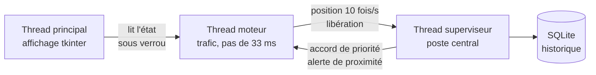
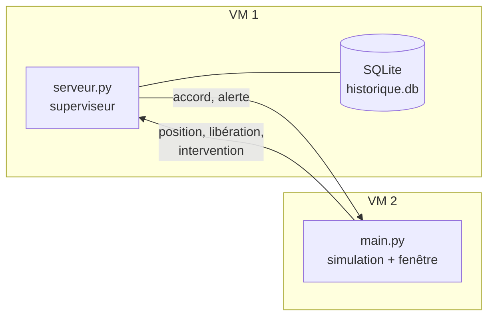

<h1 align="center">Avenue de Bâle</h1>

<p align="center">
  Priorisation des véhicules de secours en carrefour urbain connecté<br>
  <em>SAÉ R3.02 — Développer une application communicante</em><br>
  IUT de Colmar — Réseaux &amp; Télécommunications
</p>

<p align="center">
  
  
  
  
  
</p>

---

## Le problème

Quand il y a de la circulation, les véhicules d'urgence perdent du temps aux
carrefours. Les voitures n'ont pas la place de se ranger, celles qui sont
arrêtées au feu ne peuvent pas bouger. Un véhicule prioritaire a le droit de
franchir un rouge, mais sous la responsabilité du conducteur, et c'est
dangereux.

Le client, M. Frédéric Drouhin, a donc deux besoins qui vont ensemble :
**gagner du temps** sur le trajet et **éviter les accidents**. Aller plus vite
en provoquant des accidents ne réglerait rien.

## La réponse

Un simulateur qui met le dispositif en évidence et le chiffre. On y règle la
densité de circulation, on appelle un service, et on regarde le véhicule
traverser la ville — une fois avec le dispositif, une fois sans.

| Densité | Sans dispositif | Avec dispositif | Gain |
|:--:|:--:|:--:|:--:|
| 20 % | 106,0 s | 70,9 s | **33 %** |
| 60 % | 164,6 s | 70,4 s | **57 %** |
| 100 % | 204,5 s | 84,5 s | **59 %** |

<sub>Traversée de l'avenue d'ouest en est, 1,1 km et 6 carrefours, moyenne sur
8 trajets par ligne. Reproductible avec `python3 mesures.py`.</sub>

Le gain monte avec la circulation : sans dispositif le véhicule subit les
files, avec le dispositif son temps bouge à peine quelle que soit la densité.

## Démarrage

```bash
sudo apt install python3-tk     # Debian, tkinter est dans un paquet séparé
python3 main.py
```

Aucune dépendance à installer, tout vient de la bibliothèque standard. Il faut
un terminal ouvert dans la session graphique : en SSH ou en root, tkinter
répond `no display name and no $DISPLAY`.

## Ce que fait la maquette

| | |
|---|---|
| **Ville en graphe** | une avenue de 1,1 km, six rues, cinq carrefours à feux, un rond-point |
| **Trafic autonome** | jusqu'à 130 voitures qui respectent feux, stops, cédez-le-passage et priorité à droite |
| **Deux files par sens** | sans quoi une voiture ne pourrait que freiner, pas se ranger |
| **Onde verte** | les feux passent au vert devant le véhicule de secours, puis reprennent leur cycle |
| **Alerte de proximité** | les véhicules à moins de 500 m sont prévenus de son arrivée et de sa direction |
| **Rangement réaliste** | les civils se déportent progressivement sur la droite, sauf ceux qui doivent d'abord dégager le carrefour |
| **Itinéraire** | calculé par Dijkstra du bâtiment du service jusqu'au lieu d'intervention |
| **Mesure du gain** | chaque intervention est chronométrée et archivée en base |

## Architecture

Trois threads, des messages JSON, un verrou sur l'état partagé.



Le superviseur n'a pas besoin d'être dans la même application. Les mêmes
messages passent alors par une socket TCP, une ligne de JSON par message.



```bash
# sur la VM qui héberge le superviseur
python3 serveur.py

# sur la VM qui héberge la simulation
python3 main.py
```

Il n'y a aucune adresse à taper. Au démarrage, la simulation diffuse une
question en UDP sur le réseau local, le superviseur répond avec son port, et
la connexion se fait toute seule : les adresses peuvent changer d'un jour à
l'autre sans rien reconfigurer. Si personne ne répond au bout de trois
secondes, la simulation démarre son propre superviseur en local plutôt que de
s'arrêter.

`python3 main.py local` force le mode local, et `python3 main.py 192.168.1.20`
force une adresse si la diffusion est bloquée.

Les deux VM doivent être en réseau interne ou en accès par pont dans
VirtualBox : la diffusion UDP ne traverse pas le NAT.

## Les messages

Chaque message porte son type, l'identifiant de l'émetteur, l'heure et un
contenu. Les cinq premiers types sont ceux du cahier des charges, les deux
derniers servent à l'écriture en base.

```json
{"type": "accord_priorite", "emetteur": "superviseur",
 "heure": 1793956056.042,
 "contenu": {"carrefour": "C3", "axe": "vertical"}}
```

| Type | Sens | Rôle |
|---|---|---|
| `position` | véhicule → superviseur | où il est, à quelle distance du prochain carrefour |
| `demande_priorite` | véhicule → superviseur | il réclame le vert |
| `accord_priorite` | superviseur → carrefour | le vert est accordé sur cet axe |
| `alerte_proximite` | superviseur → véhicules | un secours arrive à moins de 500 m |
| `liberation` | véhicule → superviseur | le carrefour est rendu |
| `debut_intervention` | simulation → superviseur | ouvrir la ligne en base |
| `fin_intervention` | simulation → superviseur | y inscrire le temps réalisé |

## La base

Les interventions sont enregistrées dans une base SQLite, sur la machine du
superviseur. La simulation n'écrit jamais dedans : elle envoie
`debut_intervention` quand on appelle un service et `fin_intervention` quand
le véhicule arrive, et c'est le superviseur qui insère puis complète la ligne.

Le fichier `historique.db` se crée tout seul à la racine, il n'y a rien à
installer. La table `interventions` garde la date, la densité, le service, le
départ, l'arrivée, le temps avec le dispositif et le temps sans.

Pour relire l'historique :

```bash
python3 historique.py
```

Chaque trajet s'affiche sur une ligne avec sa densité, son service, son
parcours, les deux temps et le gain, et la moyenne en bas.

## Le code

| Fichier | Rôle |
|---|---|
| `main.py` | lance l'application |
| `serveur.py` | lance le superviseur seul, pour la deuxième machine |
| `mesures.py` | compare les temps avec et sans dispositif |
| `simulation/ville.py` | le plan, les rues, Dijkstra |
| `simulation/feux.py` | les feux tricolores |
| `simulation/code_route.py` | qui a le droit de passer dans un carrefour |
| `simulation/vehicule.py` | la conduite autonome des voitures |
| `simulation/secours.py` | les véhicules prioritaires |
| `simulation/simulation.py` | l'état du trafic à un instant donné |
| `simulation/affichage.py` | la fenêtre tkinter |
| `simulation/messages.py` | le format JSON des échanges |
| `simulation/superviseur.py` | le poste central |
| `simulation/moteur.py` | le thread qui fait avancer le trafic |
| `simulation/reseau.py` | le serveur TCP et son client |
| `simulation/journal.py` | la base SQLite |
| `historique.py` | affiche les interventions enregistrées |

PEP 8, noms et commentaires en français, aucune dépendance extérieure.

## L'équipe

**K2 X ERCYS** — KUM Abdulkaan et NOUMBA Keran-Lynch.

KUM Abdulkaan : interface, affichage du plan, panneau de contrôle, trafic
civil et conduite autonome. NOUMBA Keran-Lynch : modélisation de la ville,
itinéraires, superviseur, threads et base de données. À deux : le format des
messages, les tests, la documentation et le dépôt.

<sub>Maquette rendue le 15 novembre 2026. Elle ne commande aucun feu réel.</sub>
